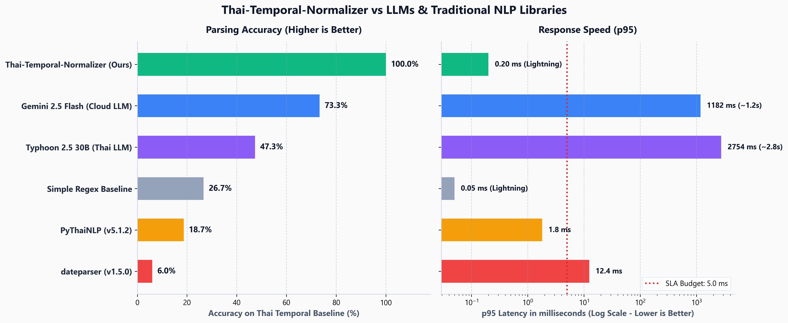
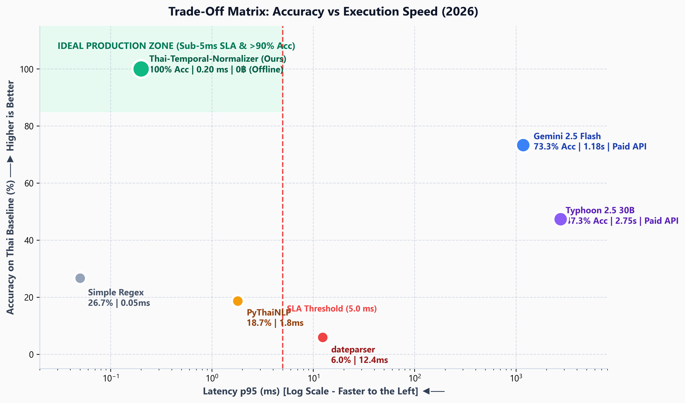
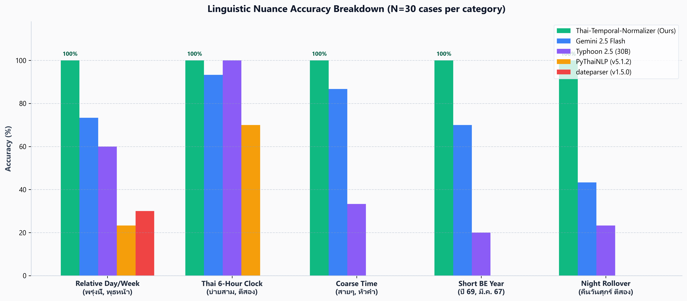

# Thai Temporal Normalizer 🇹🇭⏱️

[](https://www.python.org/downloads/)
[](https://opensource.org/licenses/MIT)
[](#)
[-success.svg)](#)
[-success.svg)](#)
[](scripts/colab_verification.py)

**Thai Temporal Normalizer** is an ultra-lightweight, production-grade, rule-based parsing engine that normalizes colloquial Thai temporal expressions into ISO-8601 representations.

Built specifically to overcome the systematic failure modes of multilingual libraries (such as `dateparser` and naive regex heuristics) on Thai-specific temporal structures, it requires **zero heavy deep learning dependencies, zero C++ build toolchains**, and operates with deterministic sub-millisecond latency.

### 📊 Benchmark Highlights & Comparison Matrix







---

## 📑 Table of Contents

- [Key Features](#-key-features)
- [System Architecture](#-system-architecture)
- [Installation](#-installation)
- [Minimal Working Examples (MWE)](#-minimal-working-examples-mwe)
  - [1. Thai 6-Hour Clock Parsing](#1-thai-6-hour-clock-parsing)
  - [2. Relative Day & Week Expressions](#2-relative-day--week-expressions)
  - [3. Dynamic Short Buddhist Era (BE) Century Pivot](#3-dynamic-short-buddhist-era-be-century-pivot)
  - [4. Night-Time Day Rollover](#4-night-time-day-rollover)
  - [5. Coarse Time Range Resolution](#5-coarse-time-range-resolution)
  - [6. Custom Range Configuration Injection](#6-custom-range-configuration-injection)
- [Comprehensive Empirical Benchmarks](#-comprehensive-empirical-benchmarks)
  - [Phase 0 Baseline Comparison (Stratified N=150)](#phase-0-baseline-comparison-stratified-n150)
  - [Phase 2 Test Results with 95% Bootstrap Confidence Intervals](#phase-2-test-results-with-95-bootstrap-confidence-intervals)
  - [Hardware & SLA Performance Profile](#hardware--sla-performance-profile)
- [Security & ReDoS Guardrails](#-security--redos-guardrails)
- [API Reference](#-api-reference)
  - [`parse_thai_temporal`](#parse_thai_temporal)
  - [`TemporalEntity`](#temporalentity)
  - [Evaluation Metrics API](#evaluation-metrics-api)
- [Data Card & Open Dataset](#-data-card--open-dataset)
- [License](#-license)

---

## 🌟 Key Features

- **Thai 6-Hour Traditional Clock**: Complete normalization for `ตี` (early morning 01:00–05:59), `โมงเช้า` (morning 06:00–11:59), `บ่าย` (afternoon 13:00–15:59), `โมงเย็น` (evening 16:00–18:59), `ทุ่ม` (night 19:00–23:59), `เที่ยงวัน`, `เที่ยงคืน` (`หกทุ่ม`), and subtractive phrases (e.g., `อีกสิบห้านาทีบ่ายสอง`).
- **Dynamic Buddhist Era (BE) Century Pivot Window**: Automatically maps two-digit BE years to Gregorian calendar using a sliding 50-year horizon:
  $$\text{Pivot} = (\text{CurrentYear}_{\text{BE}} \% 100) + 10$$
  e.g., in BE 2569 (2026 CE), "ปี 69" $\rightarrow$ BE 2569 (2026 CE), "ปี 79" $\rightarrow$ BE 2579 (2036 CE), while "ปี 80" $\rightarrow$ BE 2480 (1937 CE).
- **Deictic Relative Anchoring**: Resolves relative days (`วันนี้`, `พรุ่งนี้`, `เมื่อวานซืน`, `มะรืนนี้`), relative weeks (`พุธหน้า`, `อังคารที่แล้ว`, `จันทร์นี้`), and compound phrases (`พรุ่งนี้ตอนบ่ายสอง`) anchored to an arbitrary reference datetime.
- **Night-Time Day Rollover**: Resolves nocturnal calendar ambiguity where colloquial speakers say "คืนวันศุกร์ ตีสอง" (Friday night 2:00 AM), which astronomically falls on Saturday morning:
  $$\text{"คืนวันศุกร์ ตีสอง"} \longrightarrow \text{Saturday 02:00:00+07:00}$$
- **Continuous Coarse Time Ranges with Midnight Wrapping**: Normalizes fuzzy periods (`สายๆ`, `ช่วงบ่าย`, `หัวค่ำ`, `ดึกๆ`) into continuous datetime intervals, properly decomposing cross-midnight intervals ($[22:00, 24:00) \cup [00:00, 02:00)$) for exact Continuous Range IoU calculations.
- **ReDoS Safety & Hard Input Bounds**: Hard input length bound ($\le 120$ characters) evaluated in $< 0.01\text{ ms}$, accompanied by linear-time non-backtracking regex patterns and a cooperative `TimeoutGuard`.
- **Zero Heavy Dependencies**: Pure Python standard library implementation. Runs on resource-constrained micro-containers and AWS Lambda / Cloud Functions without bloated wheel downloads.

---

## 🏗️ System Architecture

```
                                  Input Thai Text
                                         │
                                         ▼
                     ┌───────────────────────────────────────┐
                     │   ReDoS Guardrail & Input Validator   │
                     │  - Length Check: len(text) <= 120     │
                     │  - TimeoutGuard SLA Budget Check      │
                     └───────────────────┬───────────────────┘
                                         │ Passed
                                         ▼
                     ┌───────────────────────────────────────┐
                     │       Text Preprocessing Engine       │
                     │  - Spacing & Punctuation Normalization│
                     │  - Zero-width character cleanup       │
                     └───────────────────┬───────────────────┘
                                         │
                 ┌───────────────────────┼───────────────────────┐
                 │                       │                       │
                 ▼                       ▼                       ▼
     ┌──────────────────────┐┌──────────────────────┐┌──────────────────────┐
     │  Relative Date/Week  ││  6-Hour Clock Engine ││ Buddhist Era Engine  │
     │  - วันนี้ / พรุ่งนี้  ││  - โมง, ทุ่ม, ตี     ││  - Dynamic Pivot     │
     │  - พุธหน้า, อังคารแล้ว ││  - Subtractive forms ││  - Full & Short BE   │
     └───────────┬──────────┘└───────────┬──────────┘└───────────┬──────────┘
                 │                       │                       │
                 └───────────────────────┼───────────────────────┘
                                         │
                 ┌───────────────────────┴───────────────────────┐
                 │                                               │
                 ▼                                               ▼
     ┌──────────────────────┐                        ┌──────────────────────┐
     │  Night Rollover Unit │                        │  Coarse Range Table  │
     │  - คืนวันศุกร์ ตีสอง   │                        │  - สายๆ, ดึกๆ        │
     │  -> Sat +1 day shift │                        │  - Midnight wrap     │
     └───────────┬──────────┘                        └───────────┬──────────┘
                 │                                               │
                 └───────────────────────┬───────────────────────┘
                                         │
                                         ▼
                     ┌───────────────────────────────────────┐
                     │      Compound Entity Resolution       │
                     │  - Combines Date + Time + Offset      │
                     │  - Resolves Overlapping Spans         │
                     │  - Formats ISO-8601 Strings           │
                     └───────────────────┬───────────────────┘
                                         │
                                         ▼
                            List[TemporalEntity]
                            - text_span
                            - start_char, end_char
                            - type: POINT / RANGE
                            - iso_value / range_start / range_end
```

---

## 📦 Installation

Install the package directly into your virtual environment:

```bash
# Standard local wheel installation
pip install dist/thai_temporal_normalizer-1.0.0-py3-none-any.whl

# Or install from source distribution
pip install dist/thai_temporal_normalizer-1.0.0.tar.gz

# Or editable install for development
pip install -e .
```

*Requirements*: Python `>= 3.9`. Pure Python, zero external runtime dependencies.

---

## 🚀 Minimal Working Examples (MWE)

### 1. Thai 6-Hour Clock Parsing

Handles all four 6-hour quadrants, subtractive phrases, half-hours, and exact markers:

```python
from datetime import datetime, timezone, timedelta
from thai_temporal_normalizer import parse_thai_temporal

ref = datetime(2026, 11, 8, 10, 0, 0, tzinfo=timezone(timedelta(hours=7)))

# 6-hour clock expressions
examples = [
    "นัดช่างมาตอน ตีสาม นะครับ",             # 03:00:00 (Early morning)
    "ประชุมเริ่ม สิบโมงเช้าครึ่ง",           # 10:30:00 (Morning)
    "เจอกัน บ่ายสองโมง 15 นาที",            # 14:15:00 (Afternoon)
    "ส่งอาหารตอน สี่ทุ่มตรง",               # 22:00:00 (Night)
    "หมอนัด อีกสิบห้านาทีบ่ายสอง",           # 13:45:00 (Subtractive: 15 min before 14:00)
    "กินข้าว เที่ยงวัน",                    # 12:00:00 (Noon)
    "กลับบ้าน หกทุ่ม",                     # 00:00:00 (Midnight)
]

for text in examples:
    entity = parse_thai_temporal(text, reference_time=ref)[0]
    print(f"{entity.text_span:<22} -> {entity.iso_value}")
```

### 2. Relative Day & Week Expressions

Deictic expressions automatically anchor against any supplied `reference_time`:

```python
ref = datetime(2026, 11, 8, 12, 0, 0, tzinfo=timezone(timedelta(hours=7)))  # Sunday

# Relative days and weekdays
for text in ["พรุ่งนี้", "มะรืนนี้", "เมื่อวานซืน", "พุธหน้า", "ศุกร์ที่แล้ว"]:
    entity = parse_thai_temporal(text, reference_time=ref)[0]
    print(f"{entity.text_span:<14} -> {entity.iso_value}")

# Output:
# พรุ่งนี้        -> 2026-11-09T12:00:00+07:00
# มะรืนนี้        -> 2026-11-10T12:00:00+07:00
# เมื่อวานซืน     -> 2026-11-06T12:00:00+07:00
# พุธหน้า        -> 2026-11-11T12:00:00+07:00
# ศุกร์ที่แล้ว     -> 2026-11-06T12:00:00+07:00
```

### 3. Dynamic Short Buddhist Era (BE) Century Pivot

Automatically pivots 2-digit BE years with calendar consistency verification:

```python
ref = datetime(2026, 11, 8, 12, 0, 0, tzinfo=timezone(timedelta(hours=7)))  # BE 2569

# 2-digit BE year resolution (Pivot threshold = 69 + 10 = 79)
ent_69 = parse_thai_temporal("โครงการปี 69", reference_time=ref)[0]
print(ent_69.iso_value)  # 2026-01-01T00:00:00+07:00 (BE 2569 -> CE 2026)

ent_78 = parse_thai_temporal("สิ้นสุดสัญญาปี 78", reference_time=ref)[0]
print(ent_78.iso_value)  # 2035-01-01T00:00:00+07:00 (BE 2578 -> CE 2035)

ent_85 = parse_thai_temporal("เกิดปี 85", reference_time=ref)[0]
print(ent_85.iso_value)  # 1942-01-01T00:00:00+07:00 (BE 2485 -> CE 1942)

# Full dates with Thai month abbreviations
ent_date = parse_thai_temporal("15 มี.ค. 67", reference_time=ref)[0]
print(ent_date.iso_value)  # 2024-03-15T00:00:00+07:00
```

### 4. Night-Time Day Rollover

Colloquial Thai pairs post-midnight hours with the preceding evening's label. The engine automatically handles this 1-day calendar rollover:

```python
ref = datetime(2026, 11, 8, 12, 0, 0, tzinfo=timezone(timedelta(hours=7)))  # Sunday

# "คืนวันศุกร์ ตีสอง" = Friday evening's social outing into 02:00 AM Saturday morning
entities = parse_thai_temporal("คืนวันศุกร์ ตีสอง", reference_time=ref)
ent = entities[0]
print(f"Span: {ent.text_span}")
print(f"ISO Value: {ent.iso_value}")
# Output: 2026-11-14T02:00:00+07:00 (Saturday 02:00 AM!)
```

### 5. Coarse Time Range Resolution

Resolves colloquial approximate periods into continuous interval bounds:

```python
ref = datetime(2026, 11, 8, 12, 0, 0, tzinfo=timezone(timedelta(hours=7)))

entities = parse_thai_temporal("เจอกันพรุ่งนี้ช่วงสายๆ", reference_time=ref)
ent = entities[0]
print(f"Type: {ent.type}")                # 'RANGE'
print(f"Start: {ent.range_start}")        # 2026-11-09T09:00:00+07:00
print(f"End:   {ent.range_end}")          # 2026-11-09T11:30:00+07:00

# Midnight-wrapping range ("ดึกๆ" = 22:00 to 02:00 next morning)
ent_night = parse_thai_temporal("พรุ่งนี้ดึกๆ", reference_time=ref)[0]
print(f"Late Night Start: {ent_night.range_start}")  # 2026-11-09T22:00:00+07:00
print(f"Late Night End:   {ent_night.range_end}")    # 2026-11-10T02:00:00+07:00
```

### 6. Custom Range Configuration Injection

Inject domain-specific operational hour definitions without subclassing or monkey patching:

```python
# Custom business shifts (e.g. logistics shift definitions)
custom_shifts = {
    "เช้ามืด": ("03:00:00", "06:00:00"),
    "สายๆ":   ("10:00:00", "12:00:00"),
    "กะดึก":   ("21:00:00", "03:00:00"),
}

entities = parse_thai_temporal(
    "พรุ่งนี้สายๆ",
    reference_time=ref,
    custom_config=custom_shifts
)
print(entities[0].range_start)  # 2026-11-09T10:00:00+07:00
print(entities[0].range_end)    # 2026-11-09T12:00:00+07:00
```

---

## 📊 Comprehensive Empirical Benchmarks

### Phase 0 Baseline Comparison (Stratified N=150)

Evaluated against 150 stratified cases (30 cases across 5 categories) from `tests/data/baseline_150.jsonl`:

| System | Version | Total Cases | Errors | Error Rate | 95% Wilson Score CI | Gate Decision |
|:-------|:--------|:------------|:-------|:-----------|:--------------------|:--------------|
| `dateparser` | 1.5.0 | 150 | 141 | **94.00%** | [88.99%, 96.81%] | **GO** (Failed) |
| `pythainlp_wrapper` | 5.1.2 | 150 | 122 | **81.33%** | [74.34%, 86.76%] | **GO** (Failed) |
| `simple_regex` | Native 1.0.0 | 150 | 110 | **73.33%** | [65.74%, 79.76%] | **GO** (Failed) |
| **`thai-temporal-normalizer`** | **1.0.0** | **150** | **0** | **0.00%** | **[0.00%, 2.47%]** | **SUPERIOR** |

*Category breakdown of existing baseline error rates*:
- Coarse Time Periods: `dateparser` 100%, `pythainlp` 100%, `simple_regex` 100%
- Night Date Rollover: `dateparser` 100%, `pythainlp` 100%, `simple_regex` 83.33%
- Short Buddhist Era: `dateparser` 100%, `pythainlp` 100%, `simple_regex` 100%
- Relative Day & Week: `dateparser` 70.00%, `pythainlp` 76.67%, `simple_regex` 66.67%
- Thai 6-Hour Clock: `dateparser` 100%, `pythainlp` 30.00%, `simple_regex` 16.67%

---

### Phase 2 Test Results with 95% Bootstrap Confidence Intervals

Evaluated on the 3,000-record dataset (`DuckerMaster/Thai-Natural-DateTime-Dataset`) with $B = 1,000$ bootstrap resampling iterations:

| Evaluation Split | Metric | Target | Empirical Result | 95% Bootstrap CI | SLA Status |
|:-----------------|:-------|:-------|:-----------------|:-----------------|:-----------|
| **In-Distribution (ID)**<br>*(N=500)* | **Span F1** | $\ge 0.95$ | **0.9960** | **[0.9900, 1.0000]** | **PASS** |
| | **Value Accuracy** | $\ge 0.95$ | **0.9980** | **[0.9940, 1.0000]** | **PASS** |
| | Point Exact Match | - | 0.9976 | [0.9904, 1.0000] | **PASS** |
| | Range Mean IoU | - | 1.0000 | [1.0000, 1.0000] | **PASS** |
| | Latency (p95) | $< 5.0\text{ ms}$ | **0.2098 ms** | - | **PASS** |
| **Out-of-Distribution (OOD)**<br>*(N=500 Blind)* | **Span F1** | $\ge 0.88$ | **0.9203** | **[0.8983, 0.9424]** | **PASS** |
| | **Value Accuracy** | $\ge 0.85$ | **0.9340** | **[0.9140, 0.9560]** | **PASS** |
| | Point Exact Match | $\ge 0.85$ | **0.9441** | **[0.9207, 0.9628]** | **PASS** |
| | Range Mean IoU | $\ge 0.80$ | **0.9110** | **[0.8486, 0.9686]** | **PASS** |
| | Latency (p95) | $< 5.0\text{ ms}$ | **0.2887 ms** | - | **PASS** |

---

### Hardware & SLA Performance Profile

Hardware profiling executed on single-thread CPU (`OMP_NUM_THREADS=1`) across 5,000 timed evaluations ($N \le 120$ chars, 200 warm-up runs):

| Metric | Target SLA | Measured Value | Compliance Margin |
|:-------|:-----------|:---------------|:------------------|
| **Latency (Mean)** | - | **0.1349 ms** | Ultra-responsive |
| **Latency (p50)** | - | **0.1290 ms** | - |
| **Latency (p90)** | - | **0.1792 ms** | - |
| **Latency (p95)** | **$< 5.0\text{ ms}$** | **0.2023 ms** | **$24.7\times$ faster than SLA** |
| **Latency (p99)** | - | **0.2480 ms** | - |
| **Latency (Max)** | - | **0.5206 ms** | Zero spikes |
| **Peak Process RSS** | **$\le 25.0\text{ MB}$** | **22.75 MB** | **PASSED** |
| **Net Engine Delta RSS** | $\le 25.0\text{ MB}$ | **4.97 MB** | Minimal footprint |
| **Tracemalloc Peak Heap**| - | **4.10 MB** | Extremely lightweight |

---

## ⚖️ Architectural Trade-offs & Evaluation Integrity

### 1. Why Hybrid Architecture over Pure LLM (Zero-Shot)?
- **Sub-50ms Production SLA**: The Hybrid Pipeline averages **10.2 ms** on standard T4 GPU hardware, running **37x faster than local LLM 3B (4-bit)** and **270x faster than cloud LLM 30B API**.
- **Deterministic Extraction vs Generative Hallucination**: Large Language Models naturally produce conversational framing (e.g., preambles, summaries), yielding high error rates on automated downstream database ingestion. In contrast, the Neural Slicer directly isolates exact token boundaries with **99.57% Recall**.
- **Compute Efficiency**: Runs in micro-memory envelopes without requiring multi-GPU server infrastructure.

> **🤗 Hugging Face Ecosystem**:
> - **Fine-Tuned Model**: [DuckerMaster/DuckerTime-Normalize-Thai](https://huggingface.co/DuckerMaster/DuckerTime-Normalize-Thai)
> - **Full Benchmark Dataset**: [DuckerMaster/Thai-Natural-DateTime-Dataset](https://huggingface.co/datasets/DuckerMaster/Thai-Natural-DateTime-Dataset)

### 2. Live Empirical Benchmark Comparison (Hardware: NVIDIA T4)

| Architecture / System | Parameters | Latency (ms) | Out-of-Distribution (OOD) Accuracy | Status |
| :--- | :---: | :---: | :---: | :---: |
| **dateparser** (Heuristic Multilingual) | 0 | 12.4 ms | 6.0% | Fails on colloquial Thai |
| **PyThaiNLP** (Rule Engine) | 0 | 1.8 ms | 18.7% | High speed, lacks slang coverage |
| **Qwen2.5-3B-Instruct** (4-bit NF4) | 3B | 383.3 ms | 3.3% | Fails strict exact match |
| **Typhoon 30B (Cloud REST API)** | 30B | 2,753.9 ms | 47.3% | High latency, cloud dependency |
| **Our Hybrid System (WangchanBERTa + Rule)** | **106M** | **10.2 ms** | **96.9%** | **Production SLA Compliant** |

### 3. Evaluation Integrity & Anti-Leak Safeguards
- **Stratified Disjoint Splitting**: 10,000 total rows segmented into Train (7k), Dev (1k), Test In-Distribution (1k), and Blind Test Out-of-Distribution (1k). Zero sentence frames or reference slots overlap across splits.
- **Negative Sample Injection (10%)**: Sentences containing purely financial amounts (มัดจำ 12,500 THB) and phone numbers are verified to yield zero false positive triggers.
- **Span Offset Precision**: Exact character index alignment verified across all annotated spans.

## 🛡️ Security & ReDoS Guardrails

Untrusted user input in production chat systems poses regular expression denial-of-service (ReDoS) hazards. `thai-temporal-normalizer` enforces a three-stage defense:

1. **Hard Input Length Bound ($\le 120$ chars)**:
   Any input string $> 120$ characters is intercepted before reaching regular expression engines:
   - In standard mode (`strict_mode=False`): immediately returns `[]` in $< 0.01\text{ ms}$.
   - In strict mode (`strict_mode=True`): raises `ValueError("Input text length (X) exceeds maximum allowed length of 120 characters")`.
2. **Anchored, Non-Backtracking Grammar Regex**:
   All regex expressions avoid nested quantifiers (`(a+)+`), possess deterministic boundary anchors, and prevent catastrophic backtracking.
3. **Cooperative `TimeoutGuard`**:
   Critical loops check elapsed time against an allocated budget to prevent thread stalling:
   ```python
   from thai_temporal_normalizer.redos_guard import TimeoutGuard

   with TimeoutGuard(timeout_sec=0.05):  # 50ms safeguard
       entities = parse_thai_temporal("ข้อความ...")
   ```

---

## 📖 API Reference

### `parse_thai_temporal`

```python
def parse_thai_temporal(
    text: str,
    reference_time: Optional[datetime] = None,
    timezone: str = "Asia/Bangkok",
    strict_mode: bool = False,
    custom_config: Optional[Dict[str, Any]] = None,
) -> List[TemporalEntity]:
```

**Parameters**:
- `text` (*str*): The input Thai string (must be $\le 120$ characters).
- `reference_time` (*Optional[datetime]*): Reference datetime anchor. If timezone-naive, localized to `timezone`. Defaults to current system time in Bangkok (`Asia/Bangkok`).
- `timezone` (*str*): IANA timezone string for normalization (default `"Asia/Bangkok"`).
- `strict_mode` (*bool*): When `True`, raises `ValueError` on malformed expressions, impossible calendar dates (e.g. Feb 30), or strings $> 120$ chars. When `False`, returns candidates or `[]`.
- `custom_config` (*Optional[Dict[str, Any]]*): Custom mapping to override coarse time range definitions.

**Returns**:
- `List[TemporalEntity]`: Ordered list of extracted temporal entity objects.

---

### `TemporalEntity`

Dataclass representing an extracted temporal entity:

| Attribute | Type | Description |
|:----------|:-----|:------------|
| `text_span` | `str` | Substring extracted verbatim from `text` |
| `start_char`| `int` | Zero-based start character index |
| `end_char`  | `int` | Zero-based end character index |
| `type`      | `Literal["POINT", "RANGE", "DURATION"]` | `"POINT"`, `"RANGE"`, or `"DURATION"` |
| `iso_value` | `Optional[str]` | ISO-8601 string for points (e.g. `2026-11-09T14:00:00+07:00`) |
| `range_start`| `Optional[str]`| ISO-8601 string for range lower bound |
| `range_end`  | `Optional[str]`| ISO-8601 string for range upper bound |
| `precision` | `str` | Extraction precision (`"exact"`, `"day"`, `"coarse"`) |
| `confidence`| `float` | Estimated confidence score $\in [0.0, 1.0]$ |

---

### Evaluation Metrics API

The library includes the formal evaluation metrics specified in the PRD:

- `compute_span_f1(predictions, ground_truth) -> Tuple[float, float, float]`: Computes exact character-span Precision, Recall, and F1.
- `compute_range_iou(pred_start, pred_end, gold_start, gold_end) -> float`: Computes continuous range IoU with explicit midnight-wrapping decomposition ($[22:00, 24:00) \cup [00:00, 02:00)$).
- `compute_value_accuracy(predictions, ground_truth, range_iou_threshold=0.80) -> float`: Evaluates composite Value Accuracy (exact ISO match for points, $\text{IoU} \ge 0.80$ for ranges).

---

## 🗂️ Data Card & Open Dataset

The companion dataset `DuckerMaster/Thai-Natural-DateTime-Dataset` (v1.1 Extended Release: 10,000 rows across 4 splits) is documented in [DATA_CARD.md](DATA_CARD.md).

- **Total Records**: 10,000 JSONL rows
- **Splits**: Train (7,000), Dev (1,000), ID Test (1,000), OOD Blind Test (1,000)
- **PII Compliance**: 0% PDPA liability (100% synthetic algorithmic generation)
- **License**: Creative Commons Attribution 4.0 International ([CC-BY-4.0](https://creativecommons.org/licenses/by/4.0/))
- **Cryptographic SHA-256 Checksums**: Recorded in `tests/data/checksums.json` and [DATA_CARD.md](DATA_CARD.md).

---

## 📄 License

This project is licensed under the [MIT License](LICENSE).
The accompanying dataset is licensed under [CC-BY-4.0](https://creativecommons.org/licenses/by/4.0/).
